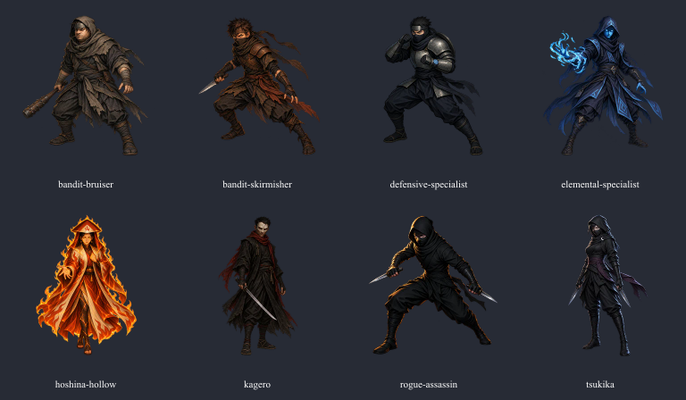

# PvE encounter artwork

The built-in imagegen tool produced eight new combat actors and one portrait for this change. Existing portraits and story illustrations are preserved. These are final raster assets, not placeholder silhouettes.

## Runtime deliverables

Actors live in `shinobij.client/src/assets/combat-actors/pve/` as `*-idle.webp`. Each is 384 × 384 with real alpha, a centered 320 × 320 source area and 32-pixel transparent padding. WebP quality is 90, alpha quality 100. Each actor is below the existing 128 KiB asset limit.

The unique Tsukika portrait is `shinobij.client/public/portraits/pve/tsukika.webp`, 512 × 512, WebP quality 88. Other public PvE portraits are copies of the existing approved artwork, selected by the sealed role/identity.

| Actor | Preserved reference | Final prompt and identity constraints |
| --- | --- | --- |
| `bandit-bruiser-idle.webp` | `src/assets/wanderers/bandit-3.webp` | Stocky broad-faced man; grey-brown hood/cowl, iron brow plate, wrapped forearms, weighted iron-studded cudgel; broad planted stance. |
| `bandit-skirmisher-idle.webp` | `src/assets/wanderers/bandit.webp` | Lean man, tousled dark hair, tawny brow wrap, black mouth scarf, brown shoulder leather, one short steel knife; nimble low stance. |
| `rogue-assassin-idle.webp` | `src/assets/village-war/merc-shadow.webp` | Strict black hood/scarf and fitted black cloth/leather, eyes visible, two short daggers; poised lateral stealth stance and restrained warm rimlight. No brown costume or exposed hair. |
| `elemental-specialist-idle.webp` | `src/assets/towers/enemies/acolyte.webp` | Blue-black rune-trimmed hooded robe, blue face/eyes, restrained cold-blue water/frost chakra in an open casting hand; stable caster stance. |
| `defensive-specialist-idle.webp` | `src/assets/towers/enemies/blocker.webp` | Same black spiked hair, plain iron brow plate and black scarf; large dull-steel segmented armor over black/navy cloth; guarded raised forearms and a small wrist ward. |
| `kagero-idle.webp` | `src/assets/wanderers/kagero.webp` | Strict established upper-face cracked ivory mask, amber eyes, short black hair, exposed mouth/jaw, worn deep-red scarf and long dark coat; slim blade held low, composed upright stance. |
| `tsukika-idle.webp` | Existing nightblade/assassin style | Original named nightblade variant: slim upright silhouette, grey eyes, dark bangs, black hood/scarf, pale crescent clasp, muted plum sash, two lowered daggers and cool moon rimlight. This override applies to the sealed name Tsukika only. |
| `hoshina-hollow-idle.webp` | `public/portraits/cinematic/storywide/kage-hoshina-enju-hollow-canon.webp` | Preserve Hoshina's face, long black hair, gold eyes/fissures, existing flame hat marking, white/red-orange robe, earrings, belt and casting gesture. Extend the thigh-cropped reference to a full lower robe, shins and shinobi sandals. The original portrait is unchanged. |

The shared generation prompt requested a single full-body, centered, combat-ready actor, three-quarter facing viewer-left, in a painterly anime-inspired fantasy-shinobi style with textured cloth/leather/steel and a readable silhouette. Every actor must include feet and held weapons, exactly two arms and legs, real transparency, and no ground shadow, scenery, text, logo, border or UI. The Hoshina extension preserves her canonical front-facing casting gesture.

Tsukika's portrait was generated from the accepted body with identity preservation: the same grey eyes, bangs, hood, black scarf, crescent clasp and plum fabric; a centered head-and-shoulders square crop against a subdued charcoal forest with cool moonlight; no text, UI or new clan emblem.

## Review and integration

All generated outputs were visually inspected. Early variants that borrowed another role's brown costume or changed Kagero's mask were rejected and regenerated from individual identity references. The three other final Kage retain their established, already full-body Hollow artwork. Hoshina alone needed a new complete body.

Preview, combat and victory select art from the same sealed identity/role. Role selection does not replace named Kagero or turn every nightblade into Tsukika. Asset tests enforce dimensions, transparency, file bounds and named-role mappings.
